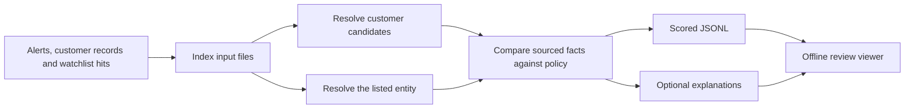

# Sanctions screening architecture and demo overview

The bank already has a list of possible watchlist matches. We built the review step that decides whether each hit is the same person or company, a different one, or a case for an analyst. The demo shows all three outcomes and the evidence behind each. A false clearance can hide a genuine match, so we require a contradiction the policy recognises before clearing a hit.

## How a hit becomes a decision



1. **Resolve the customer.** Follow an account, login or email link, with a search fallback. Use name and birth date to disambiguate joint holders. Link records with an approved document number or a shared phone plus full birth date. Prefer approved identity checks for verified facts. If several people fit, evaluate each separately and send disagreements to review.
2. **Resolve the watchlist profile.** Use structured identifiers first, then profile text and supplied search results. Check listing category and geographic ties before using a search result for a name shared by several people. Carry the origin of each fact into the comparison.
3. **Apply the policy.** Recognised contradictions can clear a hit. To confirm, a person needs name and birth-date agreement and a company needs name and country agreement, with conflicting evidence ruled out in both cases. Other cases go to review. The default Python entry point is offline and uses stable ordering and tie breaks so the same inputs produce the same file.
4. **Write the decision and show its evidence.** Each scored row carries a reason code, a short explanation and the deciding record IDs. A separate explain file carries comparisons, evidence strength, and what could settle a review. The static viewer reads the files, shows customer and hit side by side, and groups hits by alert. An alert can close once all its hits clear.

[System architecture](../system/README.md) · [Policy-to-test map](traceability.md) · [Explain format](explain-format.md)

## What broke and how we fixed it

| What we found | What we changed and why |
|---|---|
| A parser could take an uppercase status for a legal name, an expiry date for a failed check, or an unrelated year for a birth date. | We tightened identity-note checks and required a birth cue or age tied to the listed subject. Dates about relatives and numbers for fines, counts or durations carry no weight as birth-date contradictions. |
| A doubtful support note could hide an approved check. An unreadable verified date could leave a declared date looking strong enough to clear. | Doubtful support notes give way to a real check. If a verified date is unreadable, or an identity-check note could be a failed check, a declared date can support agreement only. Alert-only dates get the same treatment. An unreadable listed date can also block a clearance. |
| Reading more of a wrapped profile or checking more search keys could recover an agreeing date, but could also bring in weaker evidence. | We widened the search for agreement and kept a stricter set of dates for contradictions. A recovered date can stop a clearance. We also preserve ambiguous numeric date readings so choosing the wrong day and month cannot manufacture a mismatch. |
| Country differences could clear cases where identity still plausibly matched. The public-list run exposed this with one-part names and agreeing birth dates. | A matching short name and agreeing birth date block that geographic clearance. Unknown countries and weak ties such as travel or a superseded document can also block a clearance under the country rules. Weak ties alone cannot establish agreement. |
| Several plausible customers could produce one decision with different reasons, and the first candidate's explanation could hide the others. | We compare each candidate independently, retain evidence across candidates and explain their deciding facts within the output limit. Explicit ambiguity and missing-data cases have invented end-to-end regressions. |
| An early evidence score gave rare name matches too much weight. The alerts already select for similar names. | We capped name and country contributions. The default score and briefing explain the result. Optional model-backed note reading and clearance review remain off by default. The measured model-layer experiments used a stand-in. |

[Decision history](context/decisions.md) · [Layer comparison and regression results](results.md)

## What to show

Open [the viewer](../viewer/index.html) on its built-in invented sample. The actual pipeline generated these cards. Follow the [two-minute script](demo-script.md).

- **Clear, `H-000026`.** The verified birth date contradicts the listed year. Point to the identity check cited on the card.
- **Match, `H-00002D`.** The name and birth year agree. Show where the birth date was recovered from an identity note.
- **Review, `H-000034`.** The name and country agree, and the hit is missing a birth date. Show **What would settle it**.

```sh
python tools/make_viewer_sample.py --check
```

## What the checks tell us

The recorded development baseline (`94b96fc`) got all 50 practice labels right with zero unsafe clearances on that labelled subset. The scored and explain files were byte-identical across five fresh runs. The recorded text stress test created no new clearances. A separate historical OpenSanctions experiment used synthetic customers with known answers and exposed the short-name bug above. These checks cover the stated fixtures and revisions. Final release results belong to the submitted revision, and the organisers hold the unseen set.

For analyst operations, the assurance tool produces an alert summary, a prioritised review queue, a reproducible QA sample of clearances and a run manifest. Policy-gap research documents cases for analyst follow-up outside the scored identity rules.

[Baseline validation and release gates](release-readiness.md) · [Assurance controls](assurance.md) · [Policy gaps](context/policy-gaps.md)
