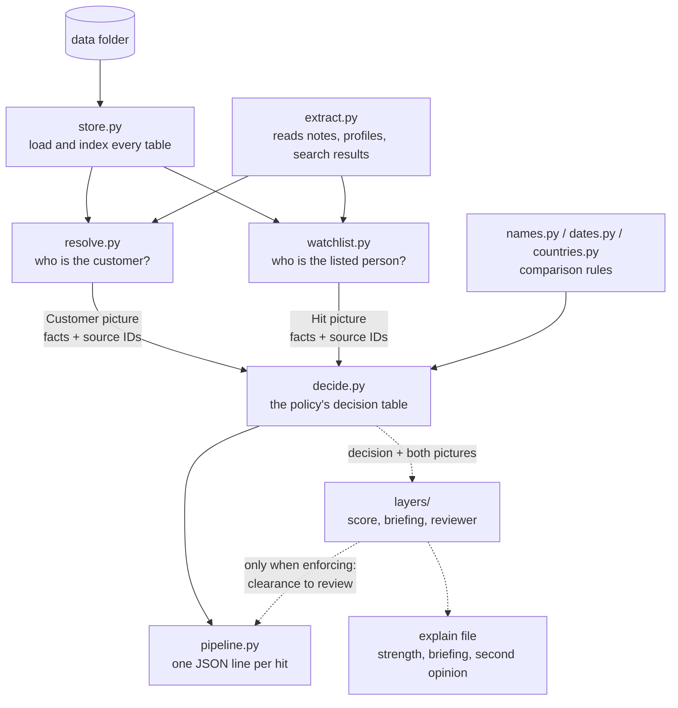

# Same Person or Not: screening alert review

For every watchlist hit raised against a customer, this system decides whether the hit is the
customer (`SAME_ENTITY`), a different person or company (`DIFFERENT_ENTITY`), or needs a person
(`REVIEW`). It follows the bank's identity SOP (`POLICY.md`) rule by rule.

```
system/run <data folder> <output file>
```

Python 3 standard library only, no installed packages. The rules make every decision; the default
run uses no language model and no network. Optional layers on top add strength of evidence, an
analyst briefing and a model's second opinion, and are described below.

## Architecture



Both sides are resolved before anything is compared. The decision step never reads raw text: it
only sees two pictures made of facts, each fact carrying the ID of the record it came from.
The dotted lines are the optional layers: they read the decision and the two pictures, write to a
separate explain file, and cannot create a clearance.

| File | Job |
|---|---|
| `screening/store.py` | Loads the JSON Lines files and indexes them by account, login, email, applicant and search key |
| `screening/resolve.py` | Customer side: follows the alert's link or searches, merges one person's records, builds the picture |
| `screening/watchlist.py` | Hit side: names, dates of birth, countries, earliest dated report, date of death |
| `screening/extract.py` | Reads free text: identity checks written as notes, birth sentences, dated reports, search results |
| `screening/names.py`, `dates.py`, `countries.py` | The comparison rules of principles 6 to 8 |
| `screening/decide.py` | Clear only on a contradiction, confirm only on agreement, otherwise review |
| `screening/pipeline.py` | Runs it and writes the output |
| `screening/layers/` | Optional layers: `score.py`, `briefing.py`, `reviewer.py`, `reader.py`, and `model.py` for the model calls |

## How we find the customer

1. **Follow the link.** `account_ref` leads to the account's holders, `login_handle` to an account
   and its customer, `email` to a record. A joint account has two holders: the screened name and
   date of birth pick between them.
2. **No link: search.** A record fits when its name agrees with the screened name (principle 8),
   its date of birth equals the screened one in every part both give, the screened country is its
   residence or nationality, and the screened city is in its city or address.
3. **One person, one picture.** Records sharing a phone number and the same full date of birth,
   or the same document number on approved checks, are merged, transitively. A shared phone alone
   does not merge.
4. **Verified beats declared.** The person's most recent approved identity check gives the legal
   name, date of birth and document country, whether it is a row in `kyc_checks` or only a note.
   Rejected and expired checks are ignored. A check read out of a note may clear a hit only when
   the note can be believed: outside the identity-check channel it must name a document, its
   legal name must share a part with a name the bank holds for the customer, and a person's date
   of birth must fall at least 14 years before the note. Otherwise what it says may support a
   match and never clears one. A support note read that way never stands in front of another
   check: it is the latest check only when it is the only kind there is. Where the verified
   date of birth cannot be read at all, or a note in the identity-check channel reads as a
   failed check, the declared date of birth may agree with a hit and never clears one: a check
   that passed can read as failed when it gives the document's expiry date. A date of birth
   that only the alert gives is treated the same way.
5. **Countries.** Residence and nationality on every record, the approved document's country,
   and every country the support notes name. A country a support note only mentions, as a
   nationality word or in a note set aside as a failed check, is not a tie, but it stops a
   location clearance against that country. So does a country named in an identity-check note
   that reads as a failed check.
6. **Several people fit.** Each is decided separately. One shared decision is given; different
   decisions become `REVIEW` with `AMBIGUOUS_CUSTOMER_RECORD`. The customer is `AMBIGUOUS` either way.

## How we find the listed person

A hit's date of birth is taken from the first place that has one:

1. its `dobs` field;
2. the opening line of its profile notes ("born on 17 July 1939", or an age at a date, which
   gives two possible birth years);
3. web search results for its name, but only a result that describes the same kind of listing
   (from the hit's primary category) in a country tied to the hit. The rest are namesakes.

A date in the `dobs` field that cannot be read is kept as unknown, not dropped. The dates that
could be read may still agree with the customer's, but they may not clear the hit, and neither
may a date from the notes or the search results: the unread date may be the one that agrees.
The one exception is a year no date here can have, such as 1340 from another calendar, which
takes no part.

Countries come from `countries`, `nationality`, `citizenship`, the last part of each address and
the place of birth. Dated reports are only the English lines of the form
`According to ...; September 10, 2025: ...`.

## How evidence is represented

Every fact is stored with its source: `(value, record ID)`. A decision cites only the sources of
the facts that decided it:

| Ground | Evidence cited |
|---|---|
| Date of birth | The check or note that gave the customer's date, plus the search result if the hit's date came from one |
| Location mismatch | Every record that ties the customer to a country |
| Location agreement | The records that give the shared country |
| Verified name mismatch | The identity check that gave the legal name |
| Date of death | The hit's `deceased_date` field, written `H-xxxxxx#deceased_date` |

The reason text opens with how the customer was found, then states each decisive fact with its
own values.

## Staying the same from run to run

There is no model, no randomness, no clock and no network in the decision path. Tables are read
in file order, every set is sorted before it is written, and ties between identity checks are
broken by date and then by ID.

This is checked, not assumed. `python tools/repro.py DATA --runs 5 --strict` starts the system as
five fresh processes, each with a different hash seed, and compares what they write. On the
development set all five scored files are byte-identical, so are the five explain files, no hit
differs in decision or reason code, and the committed `output/dev.jsonl` equals a fresh run.

A workflow (`.github/workflows/tests.yml`) runs the tests on every push: on Linux, Windows and
macOS with Python 3.10 and 3.12, on Linux with Python 3.8, and once more with a fixed hash seed. It
also checks that `system/run` is executable, starts with the `python3` line and has Unix line endings.

## Model and prompts

The decision uses no model. The policy's rules are explicit enough to run as code, and the free
text that matters has stable anchors: legal names are printed in capitals in identity notes, dates
and countries are recognisable in any wording, and listing phrases are fixed.

Two optional layers call a language model through OpenRouter. Both are off by default, and
neither can create a clearance:

- **reader** copies a legal name, a date of birth and a country out of an identity note the
  patterns cannot read. Every value it returns must appear in the note as written, or it is dropped.
- **reviewer** reads the facts behind each clearance and says whether it agrees, with one sentence of reason.

Both ask at temperature 0 with a fixed seed and a pinned model ID (`SCREENING_MODEL`), cache
every answer within a run, and treat any failure as "no answer". The prompts are in
`screening/layers/reader.py` and `screening/layers/reviewer.py`.

## Layers on top of the rules

The rules decide. Four layers add what rules alone do not: how strong the evidence is, what was
missing, and a second pair of eyes. Each one can be switched on its own, so its effect can be measured.

| Layer | What it adds | Model | Default |
|---|---|---|---|
| `score` | Strength of evidence in bits, with each field's share. A rare name or country that agrees counts for more | no | on |
| `briefing` | What decided the hit, which facts were missing, and what one more fact would settle it | no | on |
| `reviewer` | A second opinion on every clearance | yes | off |
| `reader` | Reads identity notes the patterns cannot | yes | off |

Each layer has three modes, set with `SCREENING_LAYERS` (for example `score=on,reviewer=enforce`)
or `system/layers.json`:

- `off`: it does not run.
- `on`: it writes to the explain file and changes nothing that is scored. For the reader, what it
  reads may support a match but may never clear a hit.
- `enforce`: it may also turn a clearance into a review. For the reader, what it reads counts in full.

Three guarantees hold for every layer, and `system/tests/test_layers.py` checks them:

1. With no layer enforcing, the scored file is exactly what the rules alone produce.
2. No layer can create a clearance. The only change a layer can make is clearance to review.
3. A layer that fails says nothing, and the rules' answer stands.

```
python system/run DATA output/dev.jsonl output/dev.explain.jsonl   # also write the explain file
python tools/ablate.py DATA --stress                               # compare every setting
```

The explain file is described in `docs/explain-format.md`. It carries far more of each record than
the scored file, so it is git-ignored.

### What the comparison showed

`tools/ablate.py` runs every setting on the development set and compares it with the rules alone.

| Setting | Decisions changed | Practice labels right | Verdict |
|---|---|---|---|
| rules only | 0 | 50 of 50 | the baseline |
| score on | 0 | 50 of 50 | works: adds strength and rarity, changes nothing scored |
| score enforce | 0 | 50 of 50 | harmless as calibrated; see below for the version that was not |
| briefing on | 0 | 50 of 50 | works: 881 briefings, every review says what would settle it |
| reviewer on or enforce | 0 | 50 of 50 | unproven: run with a stand-in, which agreed with all 504 clearances |
| reader on or enforce | 0 | 50 of 50 | idle here: the rules read every note in the development set, so it made no calls |

The reader only matters when notes are harder to read, so the same comparison was run on a copy
whose identity notes print the legal name without capitals:

| Setting | Decisions that differ from the clean run | Practice score | New clearances |
|---|---|---|---|
| rules only | 36 of 819 | 97.2 | 0 |
| reader on (may support, never clear) | 36 of 819 | 97.2 | 0 |
| reader enforce (counts in full) | 2 of 819 | 100 | 0 |

The rules degrade safely: 24 clearances fall back to review and nothing is wrongly cleared. A
reader that is trusted gets them back. That result is from the stand-in, which reads capitalised
words; a real model still has to earn it, and `tools/ablate.py --runs 5 --stress` is how.

**What did not work.** The first score weighed an agreeing name by its rarity with no cap, as
textbook record linkage does. A hit exists because the name is similar, so that weight was large
on almost every hit. It called 284 of 504 clearances "evidence of the same person", and enforcing
it turned 274 clearances into reviews: the practice score fell from 100 to 47, because 19 of the
28 clearances the labels confirm were among them. Capping the name at 4 bits and the country at 3
removed every false flag. What the score still flags is worth a look: everything agrees and the
contradiction is small, such as two dates in the same year.

**What the layers add that rules do not.** Of the 881 customer-against-hit comparisons on the
development set, 225 are clearances that rest on country alone while the name agrees: the policy
clears them, and the briefing says so plainly. 37 are date-of-birth clearances within three years
or within the same year. In 218 the customer is several records treated as one person. None of
this changes a decision; all of it is what an analyst would want to know.

## Controls around the decision

A bank that lets software clear alerts also has to order the open work, have a second person
check the clearances, test the name matching and record what was run. `tools/assure.py` does
that from one run and changes no decision. On the development set, 175 of the 440 alerts close
with nobody opening them, 122 of the 464 clearances are picked for a second reader (73 for a
risk flag and 49 by a fixed sample), and 187 of the 230 reviews wait for one fact: the listed
person's date of birth. The tables, and what is still missing, are in
[docs/assurance.md](../docs/assurance.md).

## Time and cost

About 6 seconds for the development set (819 hits, 72,265 customer records) on a laptop, and about
8 seconds with the explain file. The default run makes no API calls, so it costs nothing.

## Results on the practice labels

`validate.py --score` gives 50 of 50 right decisions, 0 unsafe clearances, a decision score of
100, and the reason code and customer record right on all 50. The cited evidence equals the
reference list on all 50.

## Three cases

**A clear mismatch: `H-58A39C` is `DIFFERENT_ENTITY` (`DOB_MISMATCH`).**
The alert's account reference leads to a joint account. The screened name and date of birth pick
holder `CUS-604925`. Their approved check `KYC-232AE0` verifies a date of birth of 1965-03-28; the
hit lists 1962-09-10. The customer's birth year is more than one year outside the only date the
hit gives, so the hit is contradicted. Evidence: `KYC-232AE0`.

**A match: `H-91AC66` is `SAME_ENTITY` (`NAME_DOB_MATCH`).**
The account reference leads to `CUS-962814`. The verified date of birth 1994-11-01 (`KYC-038F14`)
is one of the hit's possible years (1994, 1995), both are tied to Bangladesh, the name agrees, and
nothing contradicts. Evidence: `CUS-962814`, `KYC-038F14`.

**Left for review: `H-FA9F83` is `REVIEW` (`INSUFFICIENT_DATA`).**
The account reference leads to `CUS-783545`. Name and country agree with the hit, but the hit
gives no date of birth in its field, its profile notes or any search result about it. Nothing
contradicts and a person cannot be confirmed on name and country alone, so a person decides.
Evidence: `CUS-783545`, `KYC-80B445`.

## What is missing, honestly

- **Unreadable checks.** If an identity check written as a note cannot be read, the system does
  not guess: the declared date of birth may still agree with a hit, but it is not allowed to
  clear one.
- **Unknown countries.** A country string we cannot resolve blocks a location clearance instead
  of being ignored.
- **Unreadable dates.** A date a hit lists that cannot be read, and a verified date of birth
  that cannot be read, are unknown and not absent: what could be read may agree with the other
  side and may not clear. Where the name agrees and the other side gives a date, a country
  difference does not clear either, because the unread date may be the one that agrees.
- **A truly rejected check written as a note costs a clearance.** The rules cannot tell it from
  a check that passed and mentions an expiry date. After either, the declared date of birth may
  agree with a hit and may not clear one.
- **A doubtful note in the identity-check channel still stands in front of an earlier check.**
  It is a real check read with doubt, so it stays the latest one and cannot clear a hit; a hit
  the earlier check would have decided then goes to review, or to a match when the declared
  name and date agree. A doubtful support note is different: it no longer stands in front of
  any other check. Where a doubtful support note is the only check there is, its date still
  takes the place of the declared date of birth.
- **A city without its country is not read.** "Lived in Lagos" ties the customer to no country,
  so a location clearance against Nigeria still goes through.
- **The model layers are unproven.** They are built, tested and compared against a stand-in, not a
  real model: there was no API key when this was written. They stay off until
  `tools/ablate.py --runs 5` shows a real model is stable and creates no clearance.
- **Date of death** is read from the hit's field only, not from prose.
- **A birth year from another calendar is treated as missing.** A year such as 1340 or 1402 is
  not read as a date of birth and takes no part in a decision: it cannot agree with a date the
  bank holds. Any other listed date that cannot be read is kept as unknown, as above. Every date
  field in the development set is readable, so neither has mattered there.
- **Name particles count as name parts.** Two unrelated names that share "al" and one other
  part agree under the two-part rule. On the public list this confirmed a handful of unrelated
  names that were given the listed person's date of birth.
- **Names in other scripts** are compared as written; there is no transliteration beyond the
  variants file.
- When in doubt the answer is `REVIEW`. One wrong clearance costs as much as twenty right ones save.

## Tests

```
python -m unittest discover -s system/tests
```

| File | What it checks |
|---|---|
| `test_rules.py` | Name, date and country rules, and the decision table |
| `test_extract.py` | Reading notes, profile sentences, dated reports and search results |
| `test_pipeline.py` | 30 whole-run cases the policy covers but the development set barely shows: joint accounts, family members sharing a phone, rejected checks, checks written only as notes, companies, a date of death, namesakes in search results, no record found |
| `test_wording.py` | 15 whole-run cases of text that can be misread: capitals that are not the legal name, a year that is not a birth date, a country written as a nationality. None may clear a hit, and the controls check that a real check still does |
| `test_unreadable.py` | 35 cases of a value that cannot be read or that no record backs: one of a hit's listed dates, the date of birth on an approved check, an approved check that reads as a failed one, a date of birth only the alert gives. None may clear a hit, and the controls check that what can be read still does |
| `test_layers.py` | The three layer guarantees |
| `test_layer_*.py` | Each layer on its own |

Every rule of the policy is mapped to its function and its tests in
[docs/traceability.md](../docs/traceability.md): 31 rules, none without a test.

Every name and record in the tests is invented. `tools/stress.py` damages the real free text 14
ways. Nine take text away or reword it, and on the development set none of them creates a
clearance. Five add text that can be misread, the same wordings as `test_wording.py`. On the
development set, the rules as they were turned 129, 10, 28, 41 and 40 reviews or matches into
clearances on those five. The rules as they are turn none on any of the 14, and on four of
the five every decision is the one the undamaged text gives. The fifth, a status in capitals
in front of each identity check, sends 13 decisions to review and turns one clearance into a
match.

`python tools/loop.py DATA` is the loop to iterate with. It runs the tests, lists every hit a
change moved against the committed predictions and fails if one moved into a clearance, scores
the practice labels, then runs the stress test and the five-run check. Last, when
`data/public_demo` exists, it checks the public sanctions demo, whose answers are known by
construction.

`python tools/public_test.py` is the same idea at full size: every person and organisation on a
real public sanctions list, each with invented customers whose right answer follows from how
they were built. That is 232,142 hits, decided in 260.0 seconds with the layers off: 231,992 came out as
built, 138 went to review instead, 12 to a match, and none was cleared that should not be.
[docs/results.md](../docs/results.md) has the table and what the exceptions are. The run found
one gap in the rules, closed since: a one-part name that agrees with the hit's, with an agreeing
date of birth, was cleared on a country difference. It is a review.
