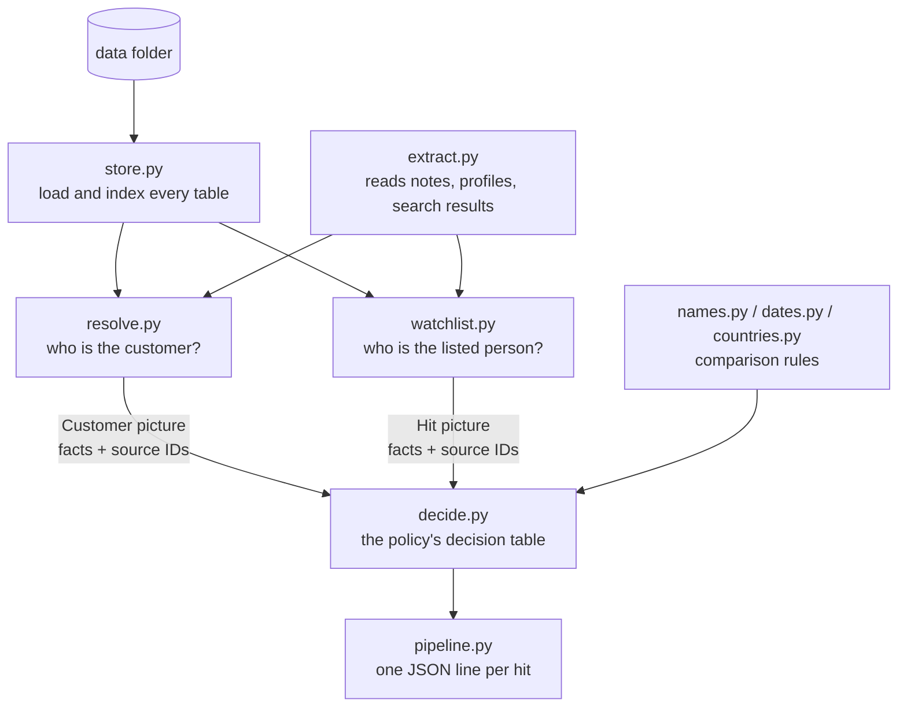

# Same Person or Not: screening alert review

For every watchlist hit raised against a customer, this system decides whether the hit is the
customer (`SAME_ENTITY`), a different person or company (`DIFFERENT_ENTITY`), or needs a person
(`REVIEW`). It follows the bank's identity SOP (`POLICY.md`) rule by rule.

```
system/run <data folder> <output file>
```

Python 3 standard library only. No language model, no network, no installed packages.

## Architecture



Both sides are resolved before anything is compared. The decision step never reads raw text: it
only sees two pictures made of facts, each fact carrying the ID of the record it came from.

| File | Job |
|---|---|
| `screening/store.py` | Loads the JSON Lines files and indexes them by account, login, email, applicant and search key |
| `screening/resolve.py` | Customer side: follows the alert's link or searches, merges one person's records, builds the picture |
| `screening/watchlist.py` | Hit side: names, dates of birth, countries, earliest dated report, date of death |
| `screening/extract.py` | Reads free text: identity checks written as notes, birth sentences, dated reports, search results |
| `screening/names.py`, `dates.py`, `countries.py` | The comparison rules of principles 6 to 8 |
| `screening/decide.py` | Clear only on a contradiction, confirm only on agreement, otherwise review |
| `screening/pipeline.py` | Runs it and writes the output |

## How we find the customer

1. **Follow the link.** `account_ref` leads to the account's holders, `login_handle` to an account
   and its customer, `email` to a record. A joint account has two holders: the screened name and
   date of birth pick between them.
2. **No link: search.** A record fits when its name agrees with the screened name (principle 8),
   its date of birth equals the screened one in every part both give, the screened country is its
   residence or nationality, and the screened city is in its city or address.
3. **One person, one picture.** Records sharing a phone number and the same full date of birth,
   or the same document number on approved checks, are merged, transitively. A shared phone alone
   does not merge.
4. **Verified beats declared.** The person's most recent approved identity check gives the legal
   name, date of birth and document country, whether it is a row in `kyc_checks` or only a note.
   Rejected and expired checks are ignored.
5. **Countries.** Residence and nationality on every record, the approved document's country,
   and every country the support notes name.
6. **Several people fit.** Each is decided separately. One shared decision is given; different
   decisions become `REVIEW` with `AMBIGUOUS_CUSTOMER_RECORD`. The customer is `AMBIGUOUS` either way.

## How we find the listed person

A hit's date of birth is taken from the first place that has one:

1. its `dobs` field;
2. the opening line of its profile notes ("born on 17 July 1939", or an age at a date, which
   gives two possible birth years);
3. web search results for its name, but only a result that describes the same kind of listing
   (from the hit's primary category) in a country tied to the hit. The rest are namesakes.

Countries come from `countries`, `nationality`, `citizenship`, the last part of each address and
the place of birth. Dated reports are only the English lines of the form
`According to ...; September 10, 2025: ...`.

## How evidence is represented

Every fact is stored with its source: `(value, record ID)`. A decision cites only the sources of
the facts that decided it:

| Ground | Evidence cited |
|---|---|
| Date of birth | The check or note that gave the customer's date, plus the search result if the hit's date came from one |
| Location mismatch | Every record that ties the customer to a country |
| Location agreement | The records that give the shared country |
| Verified name mismatch | The identity check that gave the legal name |
| Date of death | The hit's `deceased_date` field, written `H-xxxxxx#deceased_date` |

The reason text opens with how the customer was found, then states each decisive fact with its
own values.

## Staying the same from run to run

There is no model, no randomness, no clock and no network in the decision path. Tables are read
in file order, every set is sorted before it is written, and ties between identity checks are
broken by date and then by ID. Two runs on the same folder produce byte-identical files, which we
check by comparing them.

## Model and prompts

None. The policy's rules are explicit enough to run as code, and the free text that matters has
stable anchors: legal names are printed in capitals in identity notes, dates and countries are
recognisable in any wording, and listing phrases are fixed. A model would add cost and
run-to-run variation without a measurable gain on the development set.

## Time and cost

About 6 seconds for the development set (819 hits, 72,265 customer records) on a laptop. No API
calls, so no cost.

## Results on the practice labels

`validate.py --score` gives 50 of 50 right decisions, 0 unsafe clearances, a decision score of
100, and the reason code and customer record right on all 50. The cited evidence equals the
reference list on all 50.

## Three cases

**A clear mismatch: `H-58A39C` is `DIFFERENT_ENTITY` (`DOB_MISMATCH`).**
The alert's account reference leads to a joint account. The screened name and date of birth pick
holder `CUS-604925`. Their approved check `KYC-232AE0` verifies a date of birth of 1965-03-28; the
hit lists 1962-09-10. The customer's birth year is more than one year outside the only date the
hit gives, so the hit is contradicted. Evidence: `KYC-232AE0`.

**A match: `H-91AC66` is `SAME_ENTITY` (`NAME_DOB_MATCH`).**
The account reference leads to `CUS-962814`. The verified date of birth 1994-11-01 (`KYC-038F14`)
is one of the hit's possible years (1994, 1995), both are tied to Bangladesh, the name agrees, and
nothing contradicts. Evidence: `CUS-962814`, `KYC-038F14`.

**Left for review: `H-FA9F83` is `REVIEW` (`INSUFFICIENT_DATA`).**
The account reference leads to `CUS-783545`. Name and country agree with the hit, but the hit
gives no date of birth in its field, its profile notes or any search result about it. Nothing
contradicts and a person cannot be confirmed on name and country alone, so a person decides.
Evidence: `CUS-783545`, `KYC-80B445`.

## What is missing, honestly

- **Unreadable checks.** If an identity check written as a note cannot be read, the system does
  not guess: the declared date of birth may still agree with a hit, but it is not allowed to
  clear one.
- **Unknown countries.** A country string we cannot resolve blocks a location clearance instead
  of being ignored.
- **Date of death** is read from the hit's field only, not from prose.
- **Names in other scripts** are compared as written; there is no transliteration beyond the
  variants file.
- When in doubt the answer is `REVIEW`. One wrong clearance costs as much as twenty right ones save.

## Tests

```
python -m unittest discover -s system/tests
```

37 tests cover the name, date and country rules, the decision table and the free-text readers.
Every name in the tests is invented.
